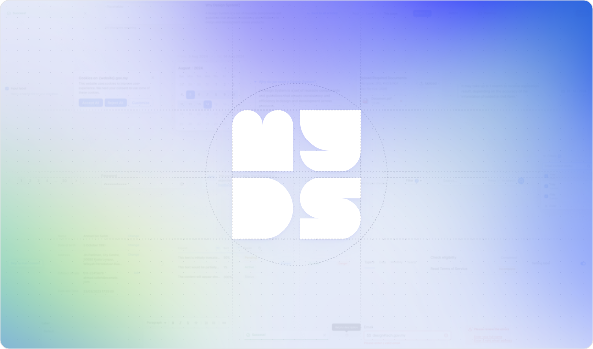

# myds-style

> This package continues `@govtechmy/myds-*` 1.x under a new name, from version 2.0.0. To switch, follow the migration guide in the [2.0.0 changelog](https://github.com/amerfathullah/myds-design-md/blob/main/packages/style/CHANGELOG.md).



> The Malaysian Government Design System (MYDS) is an open-source design system to build products for the Malaysian government. It contains the design guideline and the component library for creating consistent and accessible digital services.

## Getting started

To install `@amerfathullah/myds-style` in your project, run the installation command for the package manager of your choice:

```bash
# npm
npm i @amerfathullah/myds-style

# yarn
yarn add @amerfathullah/myds-style

# pnpm
pnpm add @amerfathullah/myds-style
```

## Usage

### With Tailwind CSS 4

Import MYDS once, after Tailwind, in your stylesheet. Every MYDS token becomes a Tailwind theme variable, with the light and dark themes, so classes such as `bg-bg-white` and `text-txt-black-900` work. Tailwind's default colour palette isn't available. If you use `@amerfathullah/myds-react`, let Tailwind scan it too:

```css
@import "tailwindcss";
@import "@amerfathullah/myds-style";

/* Path from this stylesheet to your node_modules */
@source "../node_modules/@amerfathullah/myds-react/dist";
```

The import doesn't load fonts. Load Inter and Poppins yourself, for example from Google Fonts.

For a Fumadocs site, add the MYDS colours for Fumadocs after its theme, and keep MYDS before it:

```css
@import "tailwindcss";
@import "@amerfathullah/myds-style";
@import "fumadocs-ui/css/neutral.css";
@import "fumadocs-ui/css/preset.css";
@import "@amerfathullah/myds-style/fumadocs.css";
```

### Without Tailwind

`full.css` is precompiled: Tailwind's preflight, the fonts, MYDS and every class `@amerfathullah/myds-react` uses.

```css
/* In your CSS entry point */
@import "@amerfathullah/myds-style/full.css";
```

```ts
// Or in your bundle entry point (eg. index.{ts,js})
import "@amerfathullah/myds-style/full.css";
```

`color.css` holds the CSS variables for the colours, and `light.css` and `dark.css` those for the two themes. The theme files also set the browser's `color-scheme`, `light` on `:root` and `dark` on `.dark`, so the browser draws scrollbars and form controls to match the theme. They set it in `@layer base`, so a `scheme-*` utility or an inline style still overrides it. Import `light.css` before `dark.css`, as the tokens already require: `.dark` wins over `:root` on `<html>` only because it comes later.

MYDS is an open-source project and welcomes contributions from the public. To contribute:

1. **Discuss New Features**: Before submitting a pull request (PR), please open an issue to discuss the feature you would like to add or change. This helps to ensure that your contribution aligns with the project's goals and guidelines.
2. **Submit a PR**: Once the feature has been discussed and approved, you can submit a PR with your changes. Please follow the contribution guidelines provided in the repository.

We look forward to collaborating with you to improve MYDS.

---
